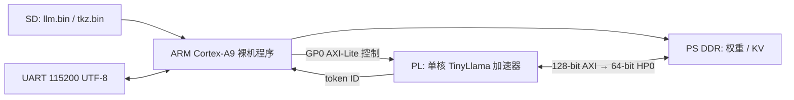

# 系统结构

SD 冷启动通过 BOOT.BIN 装载 FSBL、PL bitstream 和 PS ELF。程序将模型读取到 PS DDR，模型起始地址 `0x01000000`，为软件预留低地址空间；控制地址为 `0x43C00000`。DDR 参数依赖确切板卡预设，不能只按 FPGA 型号复制。

模型为 TinyLlama-1.1B，22 层、hidden 2048、32 个 query head、head_dim 64、MLP 5632、词表32000。将 GQA 的共享 K/V 权重重复展开为32头以匹配调度器；这改变存储量，不增加模型能力。布局见 `zynq7035_port/model_layout_zynq7035_1b.json`。

硬件使用 INT4 权重、group128、FP16 scale、INT8 KV，算术混合 FP16/FP32。这里的已测模型是 FP-minmax 导出，不应因布局格式名带 AWQ 就标成已上板 AWQ。MLP 使用 Round52 scale16 算术修正。

软件把输入模板化并编码，经硬件逐 token 执行；没有独立的并行 prefill 加速路径。每轮输入及历史最多256 token、输出最多128 token，超限按完整对话轮次裁剪。硬件1024配置与原模型2048位置编码范围均不代表当前软件能提供对应长度的聊天上下文。

Round54 修复 KV 元数据与主数据流之间的队列死锁，Round55 在 argmax 前对最近128个生成 token 使用一次9/8重复惩罚：正 logit 除、负 logit 乘，舍入到 binary16；不惩罚 prompt，ID0/1/2豁免。计算软复位清历史，重复次数不累计倍乘。
